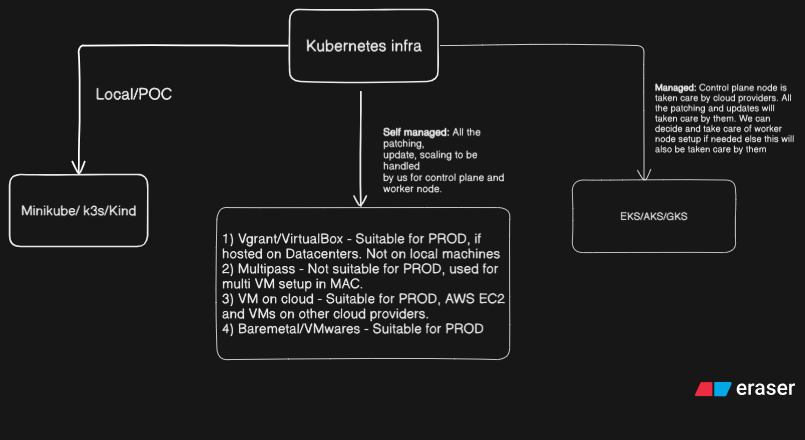

### Setting up Kubernetes Cluster

Below is the step involved in setting up the cluster

**Download Kubernetes:**

1) Downloading binaries for k8s master and control plane component and installing them on your infrastructure. This can be anything like VMs hosted on your baremetal server, directly on baremetal server, VMs on cloud providers. Binaries available for all operating system. 

2) K8s offcially releases container images for all its components and suggested to run them as contianers wherever it is possible. Container images are signed using sigstore.
https://kubernetes.io/releases/download/

**Install Tools:**

For local we can bootstrap k8s cluster using kind or minikube. For Enterprise/Production we can bootstrap the cluster using kubeadm this will help to install necessary k8s compoenent and join master and worker.

Install Kubectl, kubeadm https://kubernetes.io/docs/setup/production-environment/tools/kubeadm/install-kubeadm/

Setup cluster: https://kubernetes.io/docs/setup/production-environment/tools/kubeadm/create-cluster-kubeadm/

You can install and use kubeadm on various machines: your laptop, a set of cloud servers, a Raspberry Pi, and more. 

Whether you're deploying into the cloud or on-premises, you can integrate kubeadm into provisioning systems such as Ansible or Terraform.

**Mannaul Setup:**

In mannual setup, we have to work on VM pre setups like installing kubectl, kubelet, control plane component and worker node component. Also registering worker node needs mannaul efforts.

**Using Bootstrap Component:**

Using kubeadm, we need partial mannual interventions for below task. Rest of the things like creating static pods for control plane components and worker node components and joining worker will be done by kubeadm.

You perform these tasks:
- Provision Linux VMs.
- Disable swap (or configure it according to supported swap settings).
- Install a container runtime such as containerd.
- Install required runtime dependencies such as runc.
- Configure required kernel modules and sysctl parameters.
- Install CNI binaries if required by your chosen networking setup.
- Install kubeadm, kubelet and kubectl.

What happens automatically?
1. Generates required certificates and kubeconfig files.
2. Configures the API server endpoint and control plane settings.
3. Generates static Pod manifests for:
   - kube-apiserver
   - kube-controller-manager
   - kube-scheduler
   - etcd (for the default stacked-etcd topology)
4. Pulls the required Kubernetes container images.
5. Starts the control plane components through kubelet.
6. Configures the control plane node.

What happens automatically?
- Configures kubelet to communicate with the control plane.
- kube-proxy installed
- Establishes node authentication.
- Generates the required kubelet configuration.
- Starts the kubelet service.
- Registers the worker node with the cluster.

### Steps:

1) Create VMs for control plane and worker node.
2) Create security group to allow port and protocols for control plane component.

https://kubernetes.io/docs/reference/networking/ports-and-protocols/
3) Configure below on both master and worker node  

### Disable Swap**

Why Swap needs to be disabled on the K8s node?

- If swap is enabled there will be latency issue. Since based on the swap configuration, some data can be tranfered to swap memory which will increase latency of the application.
- Application use both swap and RAM which makes application performance less predictable and hard to manage rsource allocation.
- Since few running workloads get to use swapped memory. Memory usage is less predictable.
- Newer version of k8s support swap to be enabled. But manual configuration of cgroups required.
- The conatiner resource limit like memory and cpu all specify to available core and RAM. SSD/HDD/NAS is for persistent storage class, ephermal storage, conatiner image storage, writable layer, pod logs, OS usage.

| Feature                  | RAM                      | ROM / Firmware Flash                    | SSD                                |
| ------------------------ | ------------------------ | --------------------------------------- | ---------------------------------- |
| **Purpose**              | Temporary working memory | Stores startup instructions (BIOS/UEFI) | Stores OS, applications, and files |
| **Data after power off** | Lost (volatile)          | Retained (non-volatile)                 | Retained (non-volatile)            |
| **Can be updated?**      | Yes                      | Yes, firmware can be updated            | Yes                                |
| **Example**              | Running applications     | BIOS/UEFI                               | Windows, Chrome, documents         |
| **Usage**                | Currently running app    | Startup low level instruction           | OS, files and other                |

### Understand with a laptop example
Imagine switching on your laptop:
1. ROM / Firmware
   
   Contains BIOS/UEFI instructions. Helps initialize hardware and start the boot process.
2. SSD
   
   Stores your operating system, such as Windows.
3. RAM
   
   Windows and its running processes are loaded into RAM so the CPU can work with them.
4. Swap
   
   If configured and needed, some memory pages can be moved from RAM to disk temporarily

### Forwarding IPv4 and letting iptables see bridged traffic**

**Load kernel modules**
**Overlay driver** -> Overlay helps to unify docker read only layer and add a writable layer upon it for the conatiner related modifications.

**br_netfilter** -> Each pod get its own network interface. A virtual brigde connect one end to pod network interface and other to the host network interface. 
br_netfilter is important since, pod calls another pod using its clusterIP service. It allows Linux firewall rules (iptables or nftables) to inspect and filter network traffic passing across a Linux bridge such as the virtual bridge connecting those pod veth interfaces to the host node. This helps to get the actual connecting backend pod IP(NAT). Otherwise the request will be dropped.

• **netfilter** is the engine inside the Linux kernel: It provides the "hooks" (checkpoints) in the network stack that can inspect, drop, or rewrite packet addresses (like swapping a virtual ClusterIP for a real backend Pod IP).
• **iptables** is the rulebook/interface: It is the command-line tool that kube-proxy uses to load the translation rules (e.g., "If a packet is going to 10.96.0.10, rewrite its destination to 10.244.1.5") into netfilter.
• **br_netfilter** is the bridge connector: It plugs the virtual Linux bridge into those netfilter hooks so that packets crossing the bridge get checked against the iptables rules.

**Routing Table (ip route)**	Decides where to send a packet (local subnet vs. default gateway vs. cni0 bridge).
**IP Forwarding (ip_forward)**	Allows the kernel to move packets between different interfaces (e.g., eth0 ↔ cni0).
**br_netfilter + iptables**	Forces packets on the same bridge (cni0) to pass through iptables so kube-proxy can rewrite ClusterIPs and enforce firewall rules.

1. Pod Interface (eth0) = Computer's Network Card: Just like every physical PC has its own NIC, every pod has its own isolated network namespace and virtual NIC (eth0).
2. Linux Bridge (cni0/docker0) = Office Switch + Gateway: Just like office computers plug into a physical switch via Ethernet cables, all pods on a node plug into the cni0 bridge via veth pairs. The bridge's IP address (10.244.1.1) acts as the gateway into the host Linux kernel (and out through the host's physical eth0).
3. Host Kernel = Router + Firewall (ip_forward + br_netfilter):
	• Small nuance: A normal Linux server does have iptables/netfilter installed and running for basic host firewalling, but it has IP forwarding (ip_forward) turned OFF (so it won't route packets between interfaces like a router) and br_netfilter turned OFF (so Layer 2 bridge traffic doesn't trigger Layer 3 iptables rules).
	• Turning both ON transforms the Linux host from a simple endpoint into the "office router + NAT box" that routes pod traffic to the outside network and translates virtual ClusterIP addresses to real Pod IPs.

The Machine	Physical Server A, Server B	Pod A, Pod B
**Network Card**	Server's physical eth0	Pod's virtual eth0
**The Cable**	Physical Ethernet (Cat6 / Fiber) cable	Virtual Ethernet (veth pair)
**The Switch**	Physical Rack Switch connecting all servers	Linux Bridge (cni0 / docker0) connecting all pods
**The Router / Gateway**	Physical Core Router (192.168.1.1)	Host Linux Kernel (10.244.1.1 + ip_forward + iptables)

[ Pod eth0 ] <---(veth cable)---> [ cni0 Bridge ] <---(Linux Kernel Routing)---> [ Server eth0 ] ---> Physical Switch

Yes, interface crossing requires IP forwarding (net.ipv4.ip_forward = 1), and netfilter automatically inspects packets along that path.

Comparision:

When you run two Python applications directly on a normal Linux server without containers or Kubernetes:
• Shared Network Stack & Same IP: Both Python processes share the exact same host network namespace and the same server IP address (e.g., 127.0.0.1 for local calls, or 192.168.1.10 for network calls).
• Different Ports Are Required: Because they share one IP address, they must bind to different ports (for example, App A on 8000 and App B on 8001). If both try to bind to 8000, the second app crashes with an Address already in use error.
• Direct Loopback Communication (lo): When App A calls App B at http://127.0.0.1:8001 (or http://192.168.1.10:8001), the Linux kernel sees the destination IP belongs to the server itself. It immediately passes the data internally through the loopback interface (lo) straight to port 8001.
• None of the K8s Plumbing Needed:
	• No veth pairs or Bridges (cni0): There are no isolated network namespaces to connect.
	• No IP Forwarding (ip_forward): Traffic isn't moving between different network interfaces or subnets.
	• No br_netfilter or NAT Translation: There is no virtual ClusterIP to translate—App A already knows App B's exact IP and port.

modules-load.d: Configures modules to load automatically during boot.

cat <<EOF | sudo tee /etc/modules-load.d/k8s.conf
overlay
br_netfilter
EOF