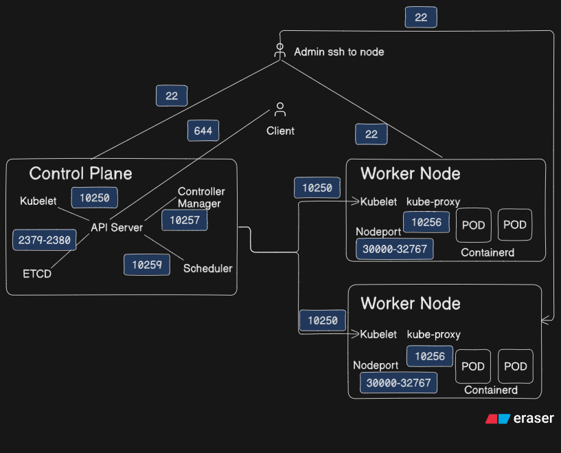

### Setting up Kubernetes Cluster

Below is the step involved in setting up the cluster

**Download Kubernetes:**

1) Downloading binaries for k8s master and control plane component and installing them on your infrastructure. This can be anything like VMs hosted on your baremetal server, directly on baremetal server, VMs on cloud providers. Binaries available for all operating system. 

2) K8s offcially releases container images for all its components and suggested to run them as contianers wherever it is possible. Container images are signed using sigstore.
https://kubernetes.io/releases/download/

**Install Tools:**

For local we can bootstrap k8s cluster using kind or minikube. For Enterprise/Production we can bootstrap the cluster using kubeadm this will help to install necessary k8s compoenent and join master and worker.

Install Kubectl, kubeadm https://kubernetes.io/docs/setup/production-environment/tools/kubeadm/install-kubeadm/

Setup cluster: https://kubernetes.io/docs/setup/production-environment/tools/kubeadm/create-cluster-kubeadm/

You can install and use kubeadm on various machines: your laptop, a set of cloud servers, a Raspberry Pi, and more. 

Whether you're deploying into the cloud or on-premises, you can integrate kubeadm into provisioning systems such as Ansible or Terraform.

**Mannaul Setup:**

In mannual setup, we have to work on VM pre setups like installing kubectl, kubelet, control plane component and worker node component. Also registering worker node needs mannaul efforts.

**Using Bootstrap Component:**

Using kubeadm, we need partial mannual interventions for below task. Rest of the things like creating static pods for control plane components and worker node components and joining worker will be done by kubeadm.

You perform these tasks:
- Provision Linux VMs.
- Disable swap (or configure it according to supported swap settings).
- Install a container runtime such as containerd.
- Install required runtime dependencies such as runc.
- Configure required kernel modules and sysctl parameters.
- Install CNI binaries if required by your chosen networking setup.
- Install kubeadm, kubelet and kubectl.

What happens automatically?
1. Generates required certificates and kubeconfig files.
2. Configures the API server endpoint and control plane settings.
3. Generates static Pod manifests for:
   - kube-apiserver
   - kube-controller-manager
   - kube-scheduler
   - etcd (for the default stacked-etcd topology)
4. Pulls the required Kubernetes container images.
5. Starts the control plane components through kubelet.
6. Configures the control plane node.

What happens automatically?
- Configures kubelet to communicate with the control plane.
- kube-proxy installed
- Establishes node authentication.
- Generates the required kubelet configuration.
- Starts the kubelet service.
- Registers the worker node with the cluster.

### Steps:

1) Create VMs for control plane and worker node.
2) Create security group to allow port and protocols for control plane component.

3) 