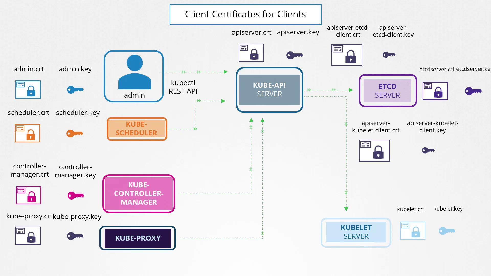

| Communication                     | Certificate used                    |
| --------------------------------- | ----------------------------------- |
| kubectl → API server              | API server presents `apiserver.crt` |
| API server → etcd                 | `apiserver-etcd-client.crt`         |
| API server → kubelet              | `apiserver-kubelet-client.crt`      |
| API server → extension API server | `front-proxy-client.crt`            |
| etcd member → etcd member         | `peer.crt`                          |
| etcd health check → etcd          | `healthcheck-client.crt`            |

Each component has its client and server certificate and use the client trust chain CA mounted in its container to verify the client certs during connections. Flow is both MTLS and one-way TLS.

| Communication                     | TLS authentication                                                  |
| --------------------------------- | ------------------------------------------------------------------- |
| kubectl → API server              | Server-authenticated TLS; mTLS if kubectl uses a client certificate |
| API server → etcd                 | mTLS                                                                |
| API server → kubelet              | Typically mTLS                                                      |
| etcd member → etcd member         | mTLS                                                                |
| API server → extension API server | TLS, with client authentication depending on configuration          |

**kubectl authentication methods:**

| Method              | Description                                             |
| ------------------- | ------------------------------------------------------- |
| Client certificates | Authenticate using a client certificate and private key |
| Bearer tokens       | Authenticate using a token                              |
| Other mechanisms    | Other supported authentication mechanisms               |