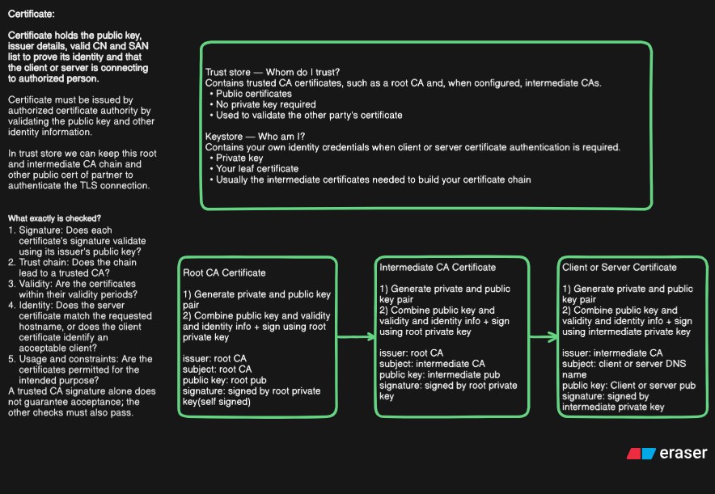

How certificates is generated?

Each party create request to a certificate authority to create certificate. The CA will validate the ownership of domain and other things to issue certificate. This certificate is also signed by the CA's own certificate root CA.

Server certificate
client certificate
Root CA + intermediate CA

**Root CA creation:**

1) key pair created
2) public key+ identity+ validity+ CA extensions  -> singed using root private key -> Root CA certificate generated(self signed certificate).

**Result:** Root CA certificate — normally self-signed.
- Subject: Root CA
- Issuer: Root CA
- public key: Root CA's public key
- Signature: Created using Root CA private key

**Intermediate CA:**

1) Key pair generated
2) CSR using public key+ identity -> submit CSR to root CA -> Signed by root private key -> Intermediate CA generated(issuer: Root CA+ signature: singed by Root CA private key)

**Result: Intermediate CA certificate.**

- Subject: Intermediate CA
- Issuer: Root CA
- Public key: Intermediate CA's public key
- Signature: Created using Root CA private key

**Client or server certificate:**

Generate the server's or client's key pair.
Create a CSR containing its public key and requested identity information.
Submit the CSR to the Intermediate CA.
The Intermediate CA validates the request and signs the issued certificate using its private key.

**Result: End-entity certificate (server or client).**
- Subject: Server or client identity
- Issuer: Intermediate CA
- Public key: Server's or client's public key
- Signature: Created using Intermediate CA private key